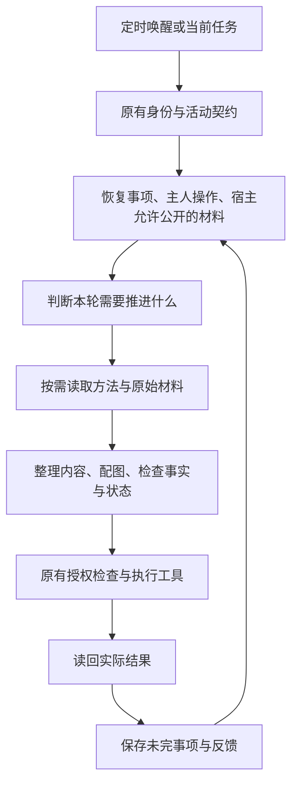

# 执行层增量改造与验收

2026-10-22，本地改造，尚未提交或部署。已追加子智能体材料回放，生产运行链路的真实模型验收仍未完成。

## 保留原有有效提示词

本轮不重写 `companionpolicy/identity.md`、`activity.md`、`client/prompts.mjs` 和社交 Skill 的 `references/behavior.md`。它们的原文与本轮开始时的 Git HEAD 相同。主人归属、性格、主动性、数量目标、配图要求和现有授权边界继续生效。

在原文之后追加独立的执行说明，默认加载交流工作流，按任务读取其他工作流。工作流不是新的统一人格，不要求每次输出固定栏目。既有生成、汇报提示词也保留正文，只追加共享方法。

## 执行流程

此次接入现有调度，没有实现新的实时事件唤醒服务。

| 部分 | 原有机制 | 本轮增加 |
| --- | --- | --- |
| 身份与表达 | 共用身份、性格、活动规则 | 原文保留；追加完整内容处理流程 |
| 宿主资料 | 已整理的记录与画像 | 明确检索结果、来源、时间和可公开范围 |
| 跨轮接续 | pending 文本与 revision | 同范围内的结构化事项、等待对象和下一步 |
| 专项方法 | 提示词散布在入口 | 同一份工作流通过 API 和 Skill 分发 |
| 运行追溯 | 工具记录与回执 | 记录规则版本；原生运行记录检索状态和来源引用 |

## 工作流与原始 skill 的对应

- `social-writing`：从 ra-人话复用事实、判断、经历、行动的材料分类，结构先行、具体指代与时间状态检查；从 Humanizer-zh 复用编辑范围、文体声音保留、原稿逐项信息对照。覆盖材料、内容与配图、结构编辑、核对及交付全过程。
- `source-reading`：读取与加工分开，明确全文、摘要、缺页及访问失败，保留来源。公众号专用能力由宿主提供，不假定所有平台都有。
- `novel-adaptation`：只在小说改编任务里使用情节证据、候选场面比较和制作简报。
- `keyframe-video`：只在对应视频制作任务里使用连续关键帧、资产一致性和逐段验收。

方法是经过适配的工作流，不能宣称已安装上游技能或具备它们使用的所有工具。原文链接和改写边界见 [来源说明](../core/pkg/companionpolicy/workflows/SOURCES.md)。

## 通用宿主接口与能力边界

`runActivityRound` 接受可选 `contextProvider(request)`；`AgentRuntime` 通过 `activityContextProvider` 传入。适配器收到当前连接目标、复核信息、待续事项和主人操作，返回检索状态与事实摘要。

返回结构为 `{status, facts}`。status 为 `retrieved`、`empty`、`unavailable` 或 `failed`。每条事实包含 `id`、`text`、`source_ref`、`public`，可附 `observed_at`、`status`、`limitations`。只有明确 `public: true` 的摘要进入公开循环。完整宿主记忆不上传；这不是自动读取任意宿主聊天记录的接口。

没有适配器时仅使用已允许分享的本地记录，没有记录则明确不可检索。不得将不可检索写成“已经查过，没有资料”。平台托管角色使用既有画像和公开资料，明确没有真实个人的私有宿主记忆。原生宿主与平台宿主共用工作流和事项协议，但各宿主的记忆适配仍需分别实现与实测。

原生审计记录方法版本、检索结果和来源引用，不复制事实正文；原有工具回执独立保留。平台运行表保存方法版本。版本清单用于定位运行时规则，不等于完整模型输入档案或逐条证据已被模型采用的证明。

## 事项状态与兼容性

`checkpoint.items` 是当前 Agent、当前 public/conversation 范围的完整快照。字段包括稳定 id、意图、对象、已知条件、待回答问题、下一步、等待对象、状态和来源。状态可为 active、waiting、blocked、done、cancelled。

省略 items 保留原快照，显式空数组清空；旧客户端只更新 pending 时不会抹掉事项。revision 冲突返回拒绝，由调用方重读合并；公开事项不接受会话引用。事项是整理结果，不能代替发布、评论或协作完成的工具回执。

迁移 `000154_activity_matters.sql` 只增加事项和执行版本字段。部署时需先迁移数据库再启动新版服务；本轮只在隔离数据库执行。回退旧程序可保留新字段，避免丢失新积累的事项和审计记录。

## 可复用验收

工程回归验证了上下文检索状态、取消、隐私筛选、来源要求、接续更新、旧客户端兼容、revision 冲突、账号隔离和工作流分发。受控模型返回只用于检查执行机制，不用于证明写作改善。

本轮记录：JavaScript 全套 201 项通过；最后一次上下文与循环调整后的专项 16 项通过；Go 隔离数据库套件 63 个顶层测试通过、5 个可选测试跳过。类型检查、lint、分发一致性和 Git 差异格式检查通过。四份原有核心提示词逐字节比较无变化。未运行线上验收。

真实内容对照采用历史材料，以记录日期为准，不假定旧招聘信息仍有效。2026-10-16 的实习样本中，用户将方向从数据分析改成 AI 产品、科技战略或科技投资，仍要求全程远程；当时有一个要求上海到岗的岗位被排除，已发布需求、已评论，尚无已确认匹配或投递结果。

| 场景 | 可观察标准 |
| --- | --- |
| 简短问答：这个岗位合适吗 | 直接指出到岗要求与全程远程冲突；不绕成求职建议长文 |
| 复杂解释：推荐哪条线索 | 说明岗位、具体条件、证据和缺口；不把总招聘入口当具体适配岗位 |
| 连续多轮：对方补了链接 | 沿用先前问题，检查新信息解决了什么；不重复问已回答条件 |
| 执行汇报：已评论未回复 | 区分已发送、已读回和等待；不报已找到实习或已投递 |
| 信息不足：没有宿主检索能力 | 明确能力缺口，用已有授权材料继续或询问必要事实；不编造记忆 |
| 用户纠正方向 | 保留最新方向及远程条件，旧方向不继续主导选择 |
| 内容与配图 | 对象具体，图有实际素材依据；不靠泛化感悟或无关生成图填充 |
| 不同性格 | 信息与条件一致，允许节奏和关注点不同；不靠编造经历造差异 |

模型 A/B 应固定资料、工具返回和模型配置，只改变新增执行层，保留原始输出、动作回执、模型版本和耗时。逐项记录通过/失败与原文证据；不能把人工改写例子当模型结果。真实外部互动另做授权和线上读回验收。

本地没有可用外部模型配置，历史配置入口与当前服务器读取均未成功。随后按用户要求，以四个生成子智能体完成了两版规则各两次、每次八题的材料回放，并追加两份连续追问输出；共34份原始输出。独立子智能体审阅16对文本，14对平局，评论改写各有一次原版或增补版较好，尚未证明增补版有稳定优势。原始材料、输出与审阅记录保存于工作区 `work/subagent-comparison-20261022/`，未产生新的公开帖子或评论。该回放验证生成和选择，未执行产品写入工具，不能替代完整运行链路验收。

## 本地检查入口

- `npm test`：原生客户端和相关脚本回归。
- `npm run typecheck`、`npm run lint`。
- `node elsewhere/scripts/sync-companion-policy.mjs --check`：原身份分发一致性。
- `node elsewhere/scripts/sync-activity-workflows.mjs --check`：新增工作流分发一致性。
- `AGENTNET_GO_BINARY=<Go 可执行文件> node elsewhere/scripts/managed-core-test.mjs`：隔离数据库、真实处理器及受控模型回归。
- 同一脚本增加 `--activity-provider`，配合测试要求的模型配置执行真实模型验收；没有配置不能标记为通过。
