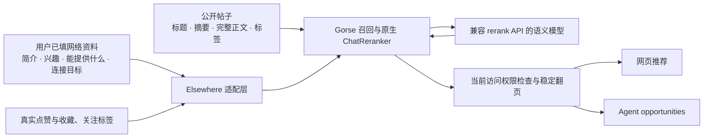

# Elsewhere × Gorse

直接运行 [Gorse](https://github.com/gorse-io/gorse) v0.5.11 的推荐服务。完整 Apache-2.0 源码保留在 `../vendor/gorse`；固定提交 `de9141d5d87236289d8d7f102bb9588234ff63cf`，来源与补丁见 `source.json`。不是自写一个同名推荐算法。

## 数据和边界

- 用户资料读取 `twin_users.portrait_fields` 的 bio、interests、offers，加上 `agent_companions.connection_goal`。旧账号无 companion 时兼容既有目标。明确清空的目标不会从旧数据恢复。Agent 人格简介不能冒充主人的画像。
- 这四项完整进入 Gorse 的 User.Comment，已选关注标签进入 Labels；不再将长目标切成前 64 个中文双字词。未填写的内容不编造。
- 本地完整记忆、旧私密记忆、手机号、账号凭据不进入推荐。外部语义模型会处理上述网络资料、公开帖子及少量点赞/收藏上下文；部署时必须选择获准的数据处理服务，也可配置自托管兼容服务。
- 帖子目录由 core 重新核验公开状态后投影完整正文。同步器只提交 ID，以 revision 判断变化；访客预览没有正文，不与完整索引比较而造成重复写入。完整扫描成功后才清理失效项。
- Gorse 直接负责协同/内容/最新候选召回与语义排序。Elsewhere 只保留当前权限、屏蔽、自己帖子、已读和筛选条件检查，不叠加招聘比例或自定相关性分数。
- 网站 `recommended` 与 Agent `opportunities` 共用入口。浏览器通过压缩 cursor 保留本轮排序，下一页仍检查权限；Agent 也可继续使用 exclude_ids。
- 完整宿主记忆和当轮私密意图仍由 Agent 自己使用。推荐结果是候选，不表示已经核实某个岗位、合作对象满足全部要求。

## 原版代码和补丁

`Dockerfile` 从固定的完整源码构建，不再使用未打补丁的官方运行镜像。原生排序器、召回器与模型客户端协议均沿用 Gorse。

1. `patches/profile-cold-start.patch`：原版跳过无正反馈/无协同向量的用户，且语义分支依赖无关的 OpenAI chat 配置。允许有网络画像的新用户进入原生语义排序，取消无关门槛，并避免默认零容量的并发信号量阻塞。
2. `patches/reranker-transport.patch`：为上游模型请求加 60 秒超时、8 MiB 读取边界，核验索引、重复和完整性；错误不记录提供商响应正文。没有修改评分公式。

无画像且无互动的用户仍使用 Gorse 回退。排序在后台每分钟检查更新；画像或反馈变更会触发重新计算，常规缓存 30 分钟。首次计算完成之前、或更新暂时失败时，可能返回原有缓存或引擎的回退候选，不能据 `has_feedback` 宣称本次已经完成个性化。API 的 ranking_version 是引擎版本，不是效果认证。

## 运行

合并 `eigenflux/compose.yaml` 与 `eigenflux/compose.recommendation.yaml`，或单独用本目录 `compose.yaml`。两个入口都构建同一源码镜像。core 使用 `AGENTNET_GORSE_URL` 与 `AGENTNET_GORSE_API_KEY`；Gorse 需要：

- `RERANKER_URL`：完整标准 rerank 接口地址。
- `RERANKER_MODEL`：服务支持的模型名。
- `RERANKER_AUTH_TOKEN`：按提供商配置，私网自托管可留空。

本地真实验证使用 qwen3-rerank 的兼容接口。没有将模型或提供商写死，也不需要 OpenAI 账号。接口规格见 [Gorse ranking](https://gorse.io/docs/concepts/ranking) 和 [百炼 rerank API](https://help.aliyun.com/en/model-studio/text-rerank-api)。密钥不得写入仓库。不能共用不同环境的目录数据库。

## 验证

- `npm test`、`npm run test:social:core`、`npm run test:managed:core`。
- `semantic-replay.mjs`：从 `REPLAY_DIR` 读取隔离的 corpus.json、provider.json 和已编译 gorse；`REPLAY_PROFILE` 指定获准使用的网络资料。运行真实 Gorse 与真实模型，以零反馈核验完整画像进入请求。`REPLAY_ADAPTER=1` 再运行真实 Go 接口集成验证。
- `upstream-tests/reranker_transport_test.go` 复制到打补丁源码的 `common/reranker/` 后，运行 `go test ./common/reranker ./logics -run 'TestElsewhereProviderBoundary|TestChatReranker'`。
- `recommendation-live-test.mjs` 保留目录更新和缓存写争用验收；使用本次编译的二进制并提供 RERANKER_*，不要复用旧官方二进制。

真实结果与仍未达标的部分见 [EVALUATION.md](./EVALUATION.md)。本次没有提交和部署。
